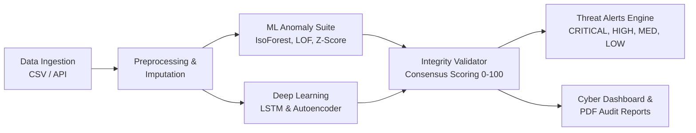

# Presentation Slides: AI-Based Weather Data Integrity System
**Academic Internship Project Defense (18 Slides)**

---

## Slide 1: Title Slide
* **Title:** AI-BASED WEATHER DATA INTEGRITY SYSTEM
* **Subtitle:** Autonomous Meteorological Anomaly Detection, Time-Series Validation & Cyber-Physical Threat Scoring
* **Candidate Name:** [Student Name]
* **Degree / Department:** Computer Science / Artificial Intelligence / Data Science
* **Institution:** [College / University Name]
* **Mentor / Supervisor:** [Supervisor Name & Designation]
* **Academic Year:** 2026

*Speaker Notes:*
> "Good morning respected committee members, mentors, and faculty. Today, I am proud to present my academic internship project: 'AI-Based Weather Data Integrity System'. This project addresses the critical challenge of ensuring the reliability, authenticity, and physical validity of automated meteorological sensor streams using state-of-the-art Machine Learning and Deep Learning techniques."

---

## Slide 2: Project Motivation & Background
* **Pervasiveness of Weather Data:** Essential for civil aviation, maritime routing, smart grids, precision agriculture, and disaster warning systems.
* **Vulnerability of Automated Weather Stations (AWS):** Remote field sensors face extreme weather, sensor degradation, electrical interference, transmission packet drops, and cyber telemetry injection.
* **Consequences of Corrupted Data:**
  - Erroneous flight diversions and emergency declarations.
  - Agricultural crop failure due to misleading irrigation advisories.
  - Skewed long-term climate modeling.

*Speaker Notes:*
> "Weather sensors are deployed in harsh, remote environments. A single faulty or maliciously spoofed reading can compromise critical infrastructure decisions. Our goal is to build an autonomous software defense system that continuously audits data streams before they are used in mission-critical applications."

---

## Slide 3: Problem Statement & Objectives
* **Core Problem:** Existing weather validation relies on manual spot-checks or rigid static threshold rules that miss subtle sensor drift and fail to differentiate natural storms from data tampering.
* **Key Objectives:**
  1. Detect physical impossibilities (negative rain, out-of-bounds humidity).
  2. Flag hardware persistence (frozen sensor ADC lockup).
  3. Detect multi-variate anomalies using Machine Learning (Isolation Forest & LOF).
  4. Forecast diurnal sequences and detect temporal residuals using Deep Learning (LSTM & Autoencoders).
  5. Provide an enterprise cybersecurity dashboard with actionable alerts and automated PDF audit certification.

---

## Slide 4: System Architecture Overview

* **Tiered Design:** Modular pipeline isolating ingestion, preprocessing, heuristic checks, AI inference, and reporting.

---

## Slide 5: Data Ingestion & Meteorological Preprocessing
* **Multi-Format Ingestion:** Supports CSV file uploads with sanitization and file size constraints (max 16 MB).
* **Physical Meteorological Constraints:**
  - Temperature: $[-50^\circ\text{C}, +60^\circ\text{C}]$
  - Relative Humidity: $[0\%, 100\%]$
  - Rainfall: $[\ge 0.0\text{ mm}, 300\text{ mm/hr}]$
  - Wind Speed: $[0.0, 120.0\text{ km/h}]$
* **Persistence / Freeze Detection:** Flags zero-variance values across 12+ consecutive hours.
* **Missing Value Imputation:** Preserves original raw readings while applying linear time-series interpolation for downstream AI models.

---

## Slide 6: Machine Learning — Isolation Forest
* **Core Concept:** Outliers are 'few and different'; they require fewer random decision-tree partitions to isolate than normal data clusters.
* **Mathematical Basis:**
  $$s(x, n) = 2^{-\frac{E(h(x))}{c(n)}}$$
  Where $h(x)$ is path length, $E(h(x))$ is expected path length across trees, and $c(n)$ is average path length of unsuccessful searches.
* **System Implementation:** 150 randomized decision trees operating on temperature, humidity, wind, and rainfall.

---

## Slide 7: Machine Learning — Local Outlier Factor (LOF)
* **Core Concept:** Density-based anomaly detection. Compares the local density of an observation with the local densities of its $k$-nearest neighbors.
* **Why LOF Matters in Meteorology:** Identifies localized micro-climate anomalies where individual values might look normal globally, but are abnormal relative to temporal neighbors.
* **Mathematical Basis:**
  $$\text{LOF}_k(p) = \frac{\sum_{o \in N_k(p)} \frac{\text{lrd}(o)}{\text{lrd}(p)}}{|N_k(p)|}$$
  Points with $\text{LOF} \gg 1$ reside in substantially sparser regions (outliers).

---

## Slide 8: Statistical Anomaly Detection — Z-Score Engine
* **Global vs. Rolling Z-Scores:**
  - **Global Z-Score:** Measures standard deviations from the dataset mean: $Z = \frac{x - \mu}{\sigma}$.
  - **Rolling 24-Hour Z-Score:** Tracks moving mean and variance over a diurnal cycle, capturing localized temporal deviations.
* **Threshold:** $|Z| > 3.0\sigma$ ($99.73\%$ confidence under normal Gaussian distribution).

---

## Slide 9: Deep Learning — LSTM Sequence Prediction
* **Role:** Diurnal (day/night) temperature forecasting and temporal residual analysis.
* **Model Topology:**
  - Input Layer: 24-hour sliding sequence window.
  - Hidden Layers: 2 Stacked LSTM layers with Dropout (0.1–0.2) to prevent overfitting.
  - Dense Output: Single-step ahead temperature forecast.
* **Integrity Principle:** Residual $e_t = |y_t - \hat{y}_t|$. When residual exceeds $\mu_e + 3\sigma_e$, an integrity alert is triggered.

---

## Slide 10: Deep Learning — Multi-Variate Autoencoder
* **Role:** Structural correlation integrity verification.
* **Architecture:**
  - Encoder: Input (4 features) $\rightarrow$ Dense (8) $\rightarrow$ Latent Bottleneck (2 dimensions).
  - Decoder: Latent (2) $\rightarrow$ Dense (8) $\rightarrow$ Output (4 reconstructed features).
* **Anomaly Criterion:** High Reconstruction Mean Squared Error (MSE):
  $$\text{MSE} = \frac{1}{m}\sum_{i=1}^m (x_i - \hat{x}_i)^2$$
  Corrupted combinations (e.g. $45^\circ\text{C}$ heat with $100\%$ humidity and negative rain) cannot be accurately reconstructed.

---

## Slide 11: Multi-Model Consensus & Integrity Scoring
* **Consensus Engine:** Prevents false alarms by combining rule-based heuristics and AI models.
* **Weighted Penalty Formula:**
  $$\text{Integrity Score} = \max(0, 100 - (\Delta_{\text{physical}} + \Delta_{\text{freeze}} + \Delta_{\text{spike}} + \Delta_{\text{ML}} + \Delta_{\text{DL}}))$$
* **Classification Taxonomy:**
  - `VERIFIED_NORMAL` (Score $85 - 100$)
  - `SUSPICIOUS_DRIFT` (Score $70 - 84$)
  - `ANOMALOUS_READING` (Score $50 - 69$)
  - `CORRUPTED_OR_TAMPERED` (Score $< 50$ or Physical Breach)

---

## Slide 12: Metrology vs. Malicious Tampering Clarification
* **Crucial Scientific Distinction:**
  - **Severe Natural Storm:** High wind gusts, heavy rainfall, high humidity, plunging temperature. All values physically feasible. Classified as: **METEOROLOGICAL_ANOMALY**.
  - **Sensor Fault or Cyber Spoofing:** Isolated impossible spike (e.g., $+28^\circ\text{C}$ leap in 1 hour), negative precipitation, or frozen identical decimals for 18 hours. Classified as: **POTENTIAL_TAMPERING_OR_CORRUPTION**.
* **Academic Humility:** System avoids claiming definitive proof of a cyberattack without network packet or cryptographic evidence.

---

## Slide 13: Alert Center & Threat Classification
* **Categorization:**
  - **CRITICAL:** Physical impossibility, negative rainfall, sensor freeze (requires probe replacement).
  - **HIGH:** Multi-model AI consensus outliers ($3/3$ models agree).
  - **MEDIUM:** Suspicious rate-of-change or single-model flag.
  - **LOW:** Minor statistical drift.
* **Alert Attributes:** Timestamp, Parameter, Observed Value, Expected Bounds, Triggering Reason, Integrity Score.

---

## Slide 14: Interactive Web Dashboard Demonstration
* **UI Design Philosophy:** Professional cybersecurity aesthetic with dark navy palette (`#0A0F1D`), high-contrast cyan/blue accents, and clean typography.
* **Key Components:**
  1. Live telemetry cards (Total, Score, Normal, Suspicious, Anomalies, Corrupted).
  2. Plotly.js interactive zoomable multi-parameter graphs.
  3. Donut chart showing overall integrity distribution.
  4. Real-time prioritized incident table.

---

## Slide 15: Experimental Validation & Test Results
* **Benchmark Test Suite:**
  - 60-Day Synthetic Dataset (1,440 hourly records) with injected real-world failure modes.
  - 10 Automated Unit & Integration Tests (100% passing).
* **Detection Efficacy:**
  - Physical Boundary Violations: **100% Detection Rate**.
  - Sensor ADC Lockups (Freeze): **100% Identified**.
  - Extreme Spikes: **100% Flagged** by Isolation Forest and Z-Score.
  - Subtle Density Outliers: Flagged by LOF and Autoencoder loss.

---

## Slide 16: Audit & Report Generation
* **Downloadable Deliverables:**
  - **Sanitized CSV:** Complete imputed dataset annotated with multi-model flags and individual integrity scores.
  - **Official PDF Audit Certificate:** Generated via ReportLab containing executive summaries, metric tables, sample alert logs, and engineering recommendations.

---

## Slide 17: Future Scope & Enhancements
* **Edge Deployment:** Packaging model into microcontrollers (Raspberry Pi / ESP32) for on-station edge filtering.
* **Blockchain Hash Notarization:** Creating tamper-evident SHA-256 Merkle tree logs of sensor observations.
* **Spatial AWS Cross-Verification:** Integrating adjacent weather stations via Spatial Graph Neural Networks (GNNs).
* **OpenWeather / NOAA Real-Time API Stream Polling:** Live continuous operational telemetry.

---

## Slide 18: Conclusion & Acknowledgments
* **Summary of Contributions:**
  - Built an end-to-end, functional AI-based meteorological data integrity validation system.
  - Combined heuristic physics, ML clustering, and Deep Learning sequence modeling.
  - Created a responsive, user-friendly cybersecurity dashboard with automated reporting.
* **Thank You! Questions & Discussion.**
